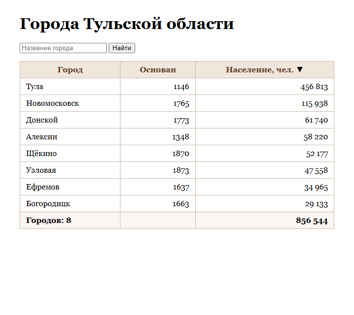
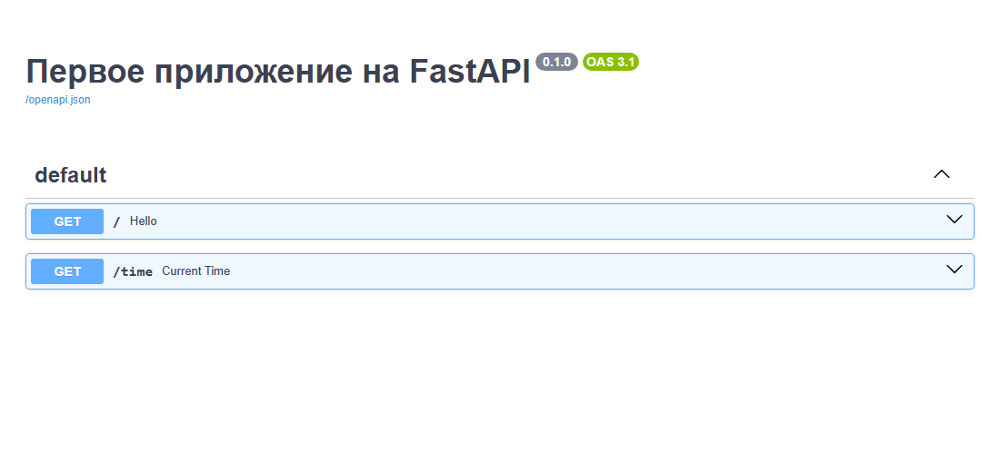
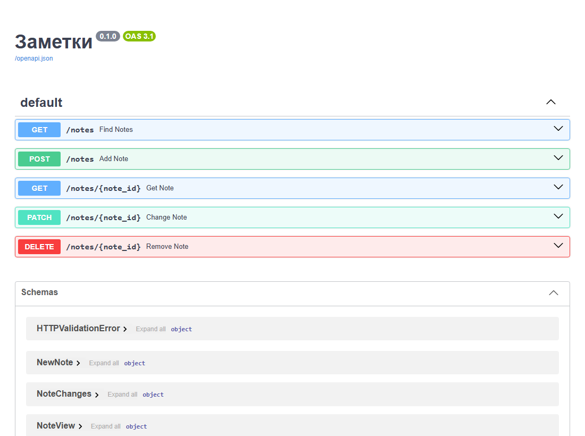

# Лабораторная работа №6. Веб-программирование на Python

**Двикалюк Мария Викторовна, группа 220042-11, вариант 4, лабораторная №6**

Дисциплина «Методы и технологии программирования» (часть 1).

## Задания варианта 4

| Сложность | № | Задание | Файл | Библиотека |
|---|---|---|---|---|
| Средняя | 4 | Страница с таблицей данных | `table_page.py` | Flask |
| Средняя | 6 | FastAPI «Hello» | `api_hello.py` | FastAPI |
| Средняя | 10 | Простейший REST API список задач | `todo_api.py` | Flask |
| Повышенная | 5 | REST API для заметок | `notes_api.py` | FastAPI |
| Повышенная | 9 | Подключение SQLAlchemy | `storage.py` | SQLAlchemy |

Каждое задание — отдельный скрипт, `menu.py` запускает любое из них.

```bash
pip install -r requirements.txt
python menu.py
python notes_api.py
python -m pytest
```

## Средняя 4. Страница с таблицей данных

Города Тульской области. Щелчок по заголовку сортирует таблицу, повторный
щелчок меняет направление, поле поиска отбирает строки. Параметры
передаются в адресе: `/?sort=people&desc=1&q=ов`. Под таблицей выводятся
число найденных городов и сумма населения.



Данные: статья «Городские населённые пункты Тульской области»,
ru.wikipedia.org.

## Средняя 6. FastAPI «Hello»

Два обработчика: `/` и `/time`. Документация — `/docs`:



## Средняя 10. REST API списка задач

Список хранится в памяти сервера, номера удалённых задач повторно не
используются. Неверный запрос возвращает код 400 с пояснением.

| Метод | Адрес | Действие |
|---|---|---|
| GET | `/tasks`, `/tasks?done=1` | все задачи или только выполненные |
| POST | `/tasks` | добавить задачу |
| GET | `/tasks/1` | одна задача |
| PATCH | `/tasks/1` | изменить название или отметку |
| DELETE | `/tasks/1` | удалить |

```
curl -X POST http://127.0.0.1:5001/tasks -H "Content-Type: application/json" -d "{\"title\": \"LR6\"}"
{"done":false,"id":1,"title":"LR6"}
```

## Повышенная 5. REST API для заметок

Заметки с метками: поиск по тексту `?q=` и по метке `?tag=`, добавление,
частичное изменение, удаление. Время создания и изменения проставляется
автоматически.



## Повышенная 9. Подключение SQLAlchemy

Модели `Note` и `Tag` со связью «многие ко многим» через таблицу
`note_tags`. Класс `NoteStorage` скрывает работу с сессиями, API получает
от него готовые словари. Одинаковые метки не дублируются. Данные лежат в
файле `notes.db` (SQLite), в тестах база создаётся в памяти.

```
$ python storage.py
Таблицы: note_tags, notes, tags
1 Лабораторная 6 | Flask, FastAPI, SQLAlchemy | ['учёба']
2 Покупки | молоко, хлеб, сыр | ['дом', 'магазин']
По тегу «дом»: ['Покупки']
```

## Тесты

```
$ python -m pytest -q
22 passed
```
